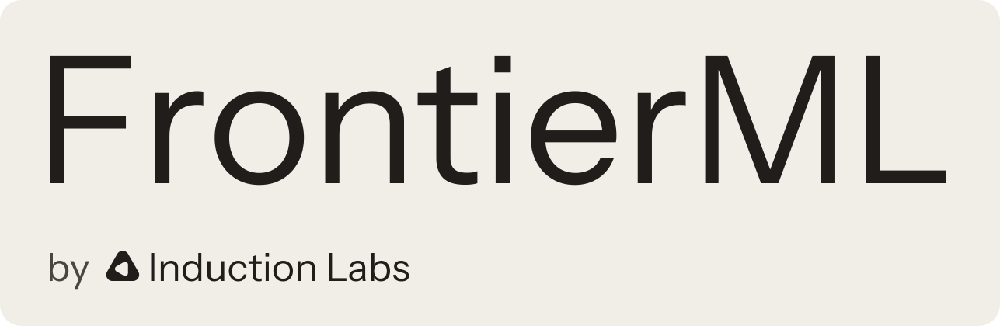

🌐 [Website](https://frontierml.org) | 🤗 [Artifacts](https://huggingface.co/datasets/inductionlabs/frontier-ml-tasks) | 🤗 [Trajectories](https://huggingface.co/datasets/inductionlabs/frontier-ml-trajectories)

FrontierML is a benchmark that measures how well agents turn capital into model performance on challenging, end-to-end machine learning tasks. Given more money, can an agent build a better model?

Each agent gets a 12-hour CPU sandbox and a fixed budget to spend on GPUs and model APIs. Tasks define a problem and its constraints, while leaving the development process open-ended: agents choose architectures, source data, run experiments, and optimize inference. They submit a standalone inference server, which we evaluate on held-out data with no internet access. A separate review agent checks the submission and its trajectory for violations of task rules.

This repository contains the 21 tasks, the evaluation infrastructure, and [Spin](spin), the service agents use to purchase compute and model tokens. Tasks span language, vision, audio, and games, from pretraining a small language model to building a competitive Pokémon battle bot. Each task's requirements are in `tasks/<task>/environment/validation/CONTRACT.md`.

<br/>

## Quickstart

Evaluations run through Harbor, with Modal providing the agent and grading environments. You need [uv](https://docs.astral.sh/uv/), a [Modal](https://modal.com) account, the credentials below, and at least 4 GB of free memory on the machine running Harbor.

For agent spending, we provide a hosted version of [Spin](https://spin.inductionlabs.com) with no added fees. Sign up there for a `SPIN_API_KEY`, or [host Spin yourself](#self-hosting-spin).

### Set up the environment

```bash
git clone https://github.com/induction-labs/frontier-ml-release
cd frontier-ml-release
uv sync

export MODAL_TOKEN_ID=... MODAL_TOKEN_SECRET=...   # or use `uv run modal token new`
export HF_TOKEN=...             # read-only access for model and dataset downloads
export ANTHROPIC_API_KEY=...    # submission review and the Claude Code agent
export OPENAI_API_KEY=...       # answer judging for 7 tasks
export SPIN_API_KEY=...         # from hosted Spin or your own Spin server
```

### Run an evaluation

Start with one task and a $50 spending budget:

```bash
uv run harbor run -y -p tasks/pii-redaction -e modal -a claude-code -m anthropic/claude-opus-5-5 \
  --plugin frontier --pk budget_usd=50
```

To run all 21 tasks concurrently with the Claude Code settings used in our evaluations:

```bash
uv run harbor run -y -p tasks -n 21 -e modal -a claude-code -m anthropic/claude-opus-5-5 \
  --ak version=2.1.282 --ak reasoning_effort=xhigh \
  --ak disallowed_tools=ScheduleWakeup,CronCreate,CronDelete,CronList \
  --plugin frontier --pk budget_usd=50
```

Harbor runs Claude Code in `--print` mode, which exits instead of waiting for a scheduled wakeup or cron prompt, so those tools are disabled.

The budget applies to each trial: the second command allocates a separate $50 wallet to each of the 21 tasks. Change `budget_usd` to evaluate at another spending level; our evaluations use $10, $50, and $200.

A trial allows up to 12 hours for the agent and up to 22 additional hours for grading. Run long jobs in `tmux` or with `nohup`, since closing the terminal cancels the job. If Harbor is forcibly killed, for example because it runs out of memory, Modal sandboxes and Spin wallets can remain active and require manual cleanup.

The `-y` flag accepts Harbor's credential-access prompt, which lists the credentials available to the verifiers. Include it for unattended runs; without it, a run with no terminal stops at that prompt.

### View results

Results are saved under `jobs/<job>/<trial>/`. To browse them:

```bash
uv run harbor view jobs
```

For Claude Code, the viewer also shows the agent's trajectory while the trial is running. Each trial's final score, from 0 to 1, is written to `verifier/reward.txt`, with grading details in `verifier/result.json`.

<br/>

## How evaluation works

1. **Develop.** Before the agent starts, the sandbox downloads the task's public examples from [`inductionlabs/frontier-ml-tasks`](https://huggingface.co/datasets/inductionlabs/frontier-ml-tasks) into `/task/public`. The agent reads `/task/CONTRACT.md` and uses the `spin` command to rent GPUs and call models, paying from its trial's wallet.
2. **Validate and submit.** The agent can run `frontier selfcheck` up to four times to test its submission on the grading infrastructure against public validation samples. It then submits the code and model weights in `/workspace/output/` with `frontier submit`.
3. **Evaluate.** The verifier starts the submission's `serve.sh` on a Modal H100 with no network access, sends held-out requests, and checks the task's speed and output-format requirements. The `llm-diffusion` task uses four H100s.
4. **Review.** Claude Opus 5.5 examines the submission and the agent's trajectory for model provenance and compliance with task rules.

The `frontier` plugin creates one Spin wallet per trial and closes it when the trial ends, stopping any compute still running through that wallet.

### Costs

The wallet covers the GPUs and model API calls the agent purchases through Spin. It does not cover the coding agent's own model calls or the evaluation infrastructure. Grading is billed separately and can use up to about 22 hours of H100 time per trial, plus an Opus review; `llm-diffusion` uses four GPUs.

A wallet never spends more than its budget, so agent compute is capped at the budget per trial. Our evaluations ran each of the 21 tasks at $10, $50 and $200, which bounds agent compute for one full sweep at (10 + 50 + 200) × 21 = $5,460.

By default, wallets are charged fixed prices for each GPU type so that the same budget buys the same amount of compute across runs. See [Self-hosting Spin](#self-hosting-spin) for how wallet charges relate to provider bills.

<br/>

## Configuration

Pass options to the `frontier` plugin with `--pk <option>=<value>`.

| Option | Default | Description |
| --- | --- | --- |
| `budget_usd` | `50` | Spending budget per trial, in US dollars |
| `static_pricing` | `true` | Use fixed GPU prices; set `false` for market prices, or supply a JSON price table or `@path` |
| `selfchecks` | `4` | Number of allowed `frontier selfcheck` calls; `0` disables them |
| `wallet_seconds` | Agent time limit + 2 hours | Wallet lifetime in seconds |
| `keep_submission_volume` | `0` | Set `1` to retain graded submissions on Modal for later regrading |
| `live_trajectory_seconds` | `120` | Interval between live Claude Code trajectory updates in `harbor view`; `0` disables updates |

### Test the infrastructure

To check the sandboxes and grading pipeline without running an agent:

```bash
FML_REVIEW_SKIP=1 uv run harbor run -y -p tasks/pii-redaction -e modal -a oracle \
  --plugin frontier --pk budget_usd=1
```

This uses the task's minimal interface server and skips submission review. The server scores zero; this run checks that the infrastructure works.

<br/>

## Self-hosting Spin

You can run Spin from this repository using your own Modal and Vast.ai accounts:

```bash
export MODAL_TOKEN_ID=... MODAL_TOKEN_SECRET=...   # Modal CPU and GPU sandboxes
export VAST_API_KEY=...                            # Vast.ai GPU machines (optional)
export OPENROUTER_API_KEY=...                      # model calls for the agent (optional)
uv run spin serve --tunnel
```

The server prints `SPIN_BASE_URL` and `SPIN_API_KEY`. Export both in the shell where you run Harbor.

Agent sandboxes need to reach the server over HTTPS. The `--tunnel` flag opens a [Cloudflare quick tunnel](https://developers.cloudflare.com/cloudflare-one/connections/connect-networks/do-more-with-tunnels/trycloudflare/), which requires `cloudflared` to be installed. Keep the server running during evaluations; the tunnel URL changes on restart. Alternatively, expose the server yourself and pass its URL with `--public-url`. Run `uv run spin serve --help` for wallet storage options used by `spin s5cmd`.

Self-hosted Spin uses the same fixed GPU prices as hosted Spin by default. The prices in [`spin/prices.json`](spin/prices.json) are based on the median on-demand price across 19 providers on October 2, 2026. These prices determine how much of the agent's wallet is spent. You pay Modal and Vast.ai their actual rates, which for Modal are well above the index prices. Run `uv run spin wallet list` to see both wallet spending (`spent_usd`) and provider costs (`cost_usd`).

<br/>

## License

The code is licensed under [Apache-2.0](LICENSE). Task datasets retain their sources' licenses; see each task's `CONTRACT.md` and `NOTICE` files.

<br/>

## Citation

```bibtex
@misc{frontierml2026,
  title        = {FrontierML: A Challenging, End-to-End Machine Learning Benchmark},
  author       = {{Induction Labs}},
  year         = {2026},
  month        = oct,
  howpublished = {\url{https://frontierml.org}},
}
```
